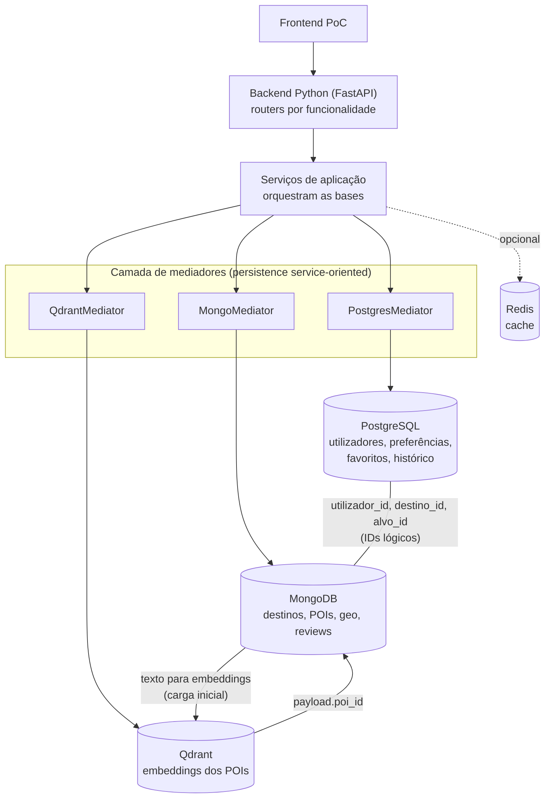
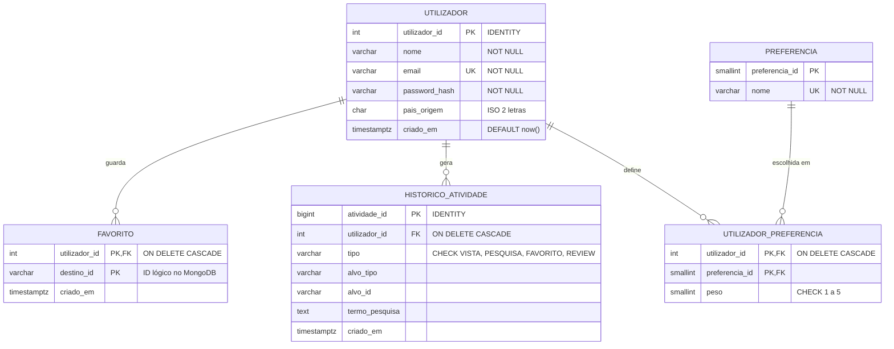
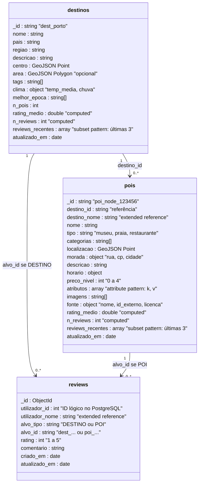
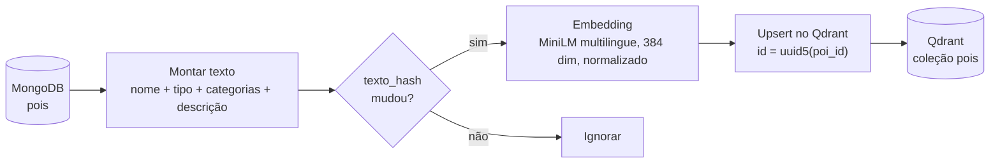
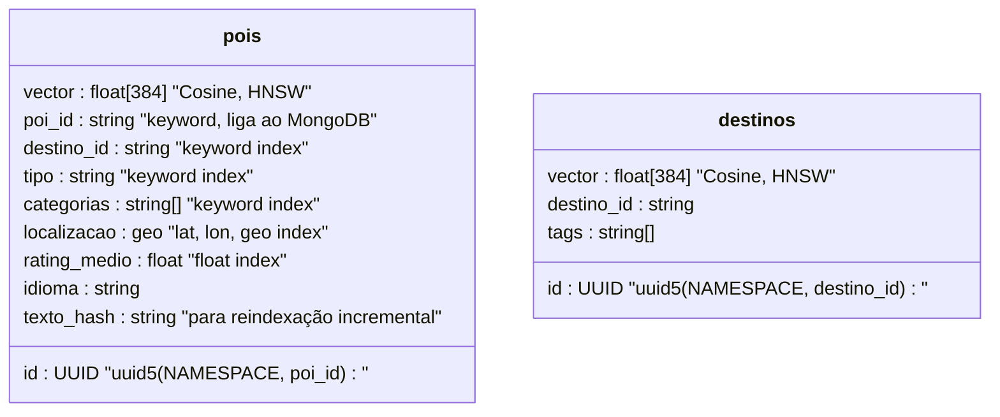
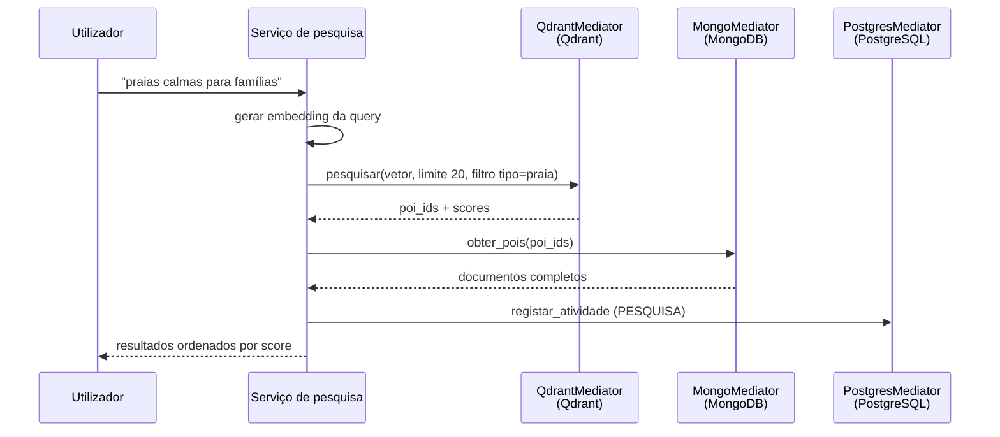
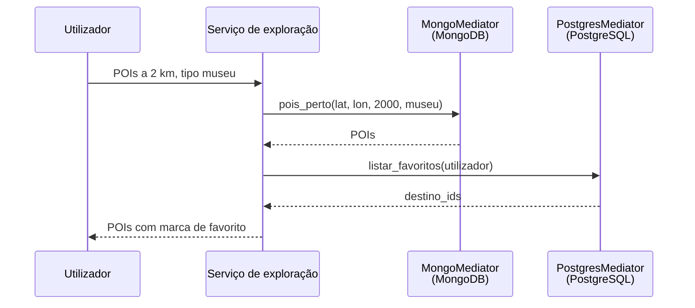
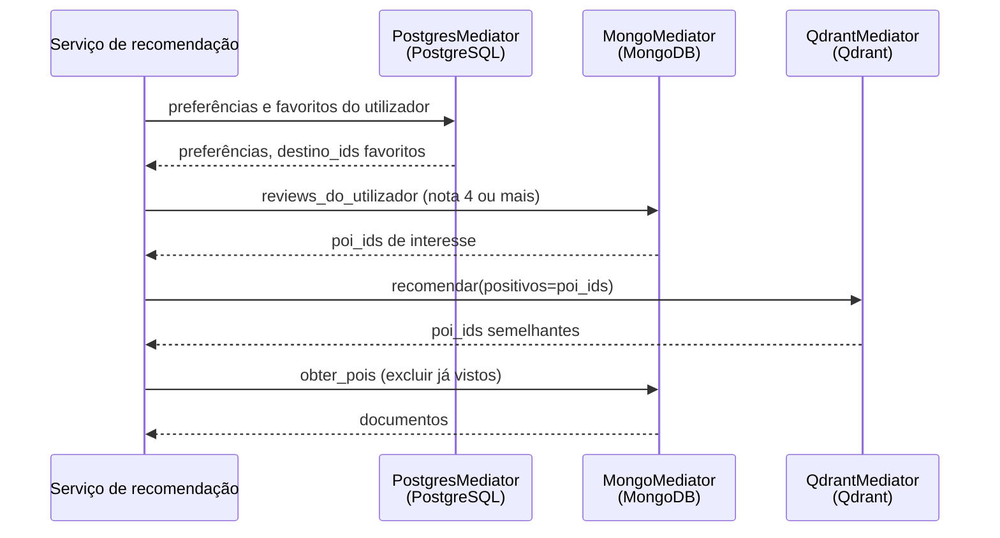
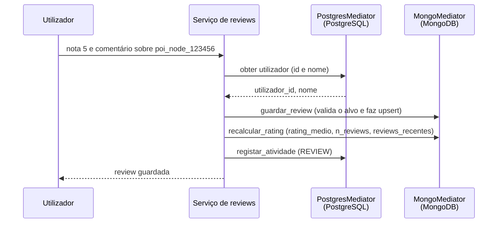

# Smart Tourism Platform – Esquemas e mapeamento entre bases de dados

Propostas de modelação para a Parte I do projeto (PostgreSQL, MongoDB, Qdrant). Assume-se Qdrant como base vetorial e `paraphrase-multilingual-MiniLM-L12-v2` (384 dimensões) para os embeddings. Tudo deve ser alinhado entre os três membros do grupo.

## 1. Visão geral e fronteiras



| Base | Guarda | Porquê |
|---|---|---|
| PostgreSQL | Perfil, preferências, favoritos e histórico de atividade (dados relacionais e transacionais) | Integridade referencial, unicidade, transações ACID sobre os dados do utilizador |
| MongoDB | Conteúdo turístico semi-estruturado e geográfico, e as reviews | Esquema flexível por tipo de POI, índice `2dsphere`, reviews lidas por alvo sem JOINs, leitura de um agregado numa só query |
| Qdrant | Vetores dos POIs e destinos | Pesquisa por similaridade com índice HNSW persistido |

Um **POI** (*Point of Interest*) é um local concreto que um turista pode visitar (museu, praia, restaurante, miradouro). Um **destino** é uma zona geral (Porto, Algarve) que contém vários POIs.

### 1.1 Camada de mediadores (persistence service-oriented)

A aplicação não acede diretamente às bases. Segue o padrão *Persistence Service-oriented* dos slides (Lajam & Mohammed, 2022): o acesso à base fica desacoplado dos módulos da aplicação através de um **mediador**, um módulo com uma API própria que é o único com acesso e controlo sobre a respetiva base.

Escolheu-se a variante em que os mediadores são módulos da própria aplicação e expõem a API por chamadas a funções públicas (diagrama inferior do slide), e não microserviços independentes ligados por rede (diagrama superior). Numa PoC com um só backend evita latência de rede e mais serviços para gerir. Mantém a evolução em aberto: como os serviços só conhecem a interface do mediador, cada um pode passar a serviço independente sem alterar a lógica de negócio.

| Mediador | Base | Responsabilidades | Métodos de exemplo |
|---|---|---|---|
| `PostgresMediator` | PostgreSQL | SQL, transações, validação de utilizadores | `criar_utilizador`, `guardar_preferencias`, `adicionar_favorito`, `listar_favoritos`, `registar_atividade`, `historico_recente` |
| `MongoMediator` | MongoDB | Consultas e agregações, pesquisa geográfica, reviews e recálculo do rating | `obter_destino`, `obter_pois(ids)`, `pois_perto(lat, lon, raio_m, tipo)`, `guardar_review`, `reviews_do_alvo`, `reviews_do_utilizador(rating_min)`, `recalcular_rating(alvo)` |
| `QdrantMediator` | Qdrant | Coleção, filtros de payload, mapeamento `poi_id` para `uuid5` | `indexar_poi`, `pesquisar(vetor, filtros, limite)`, `recomendar(positivos, negativos, limite)` |

Regras:

- Routers e serviços não importam os drivers (`psycopg`, `pymongo`, `qdrant_client`). Só chamam métodos dos mediadores.
- Os mediadores escondem a linguagem de cada base (SQL, MQL, filtros do Qdrant) e os detalhes dos identificadores, como o `uuid5(poi_id)`.
- A lógica que cruza bases (pesquisa semântica, explorar perto de mim, recomendações, escrever reviews) fica nos serviços. Cada mediador conhece uma única base.
- As referências lógicas entre bases (sem FK) são validadas pelos serviços, através dos mediadores, antes de escrever.
- O modelo de embeddings é um componente à parte, usado pelos serviços de pesquisa e pela carga. O `QdrantMediator` recebe vetores já calculados.

---

## 2. PostgreSQL (relacional)

### 2.1 Modelo ER com tipos e restrições



As reviews não estão no PostgreSQL: vivem no MongoDB (secção 3), que guarda `utilizador_id` como ID lógico. O PostgreSQL fica com os dados em que a integridade entre tabelas importa (perfil, preferências, favoritos e histórico).

### 2.2 DDL proposto

```sql
CREATE TABLE utilizador (
    utilizador_id INT GENERATED ALWAYS AS IDENTITY PRIMARY KEY,
    nome          VARCHAR(100) NOT NULL,
    email         VARCHAR(255) NOT NULL UNIQUE,
    password_hash VARCHAR(255) NOT NULL,
    pais_origem   CHAR(2),
    criado_em     TIMESTAMPTZ NOT NULL DEFAULT now()
);

CREATE TABLE preferencia (
    preferencia_id SMALLINT GENERATED ALWAYS AS IDENTITY PRIMARY KEY,
    nome           VARCHAR(50) NOT NULL UNIQUE
);

CREATE TABLE utilizador_preferencia (
    utilizador_id  INT NOT NULL REFERENCES utilizador ON DELETE CASCADE,
    preferencia_id SMALLINT NOT NULL REFERENCES preferencia,
    peso           SMALLINT NOT NULL DEFAULT 3 CHECK (peso BETWEEN 1 AND 5),
    PRIMARY KEY (utilizador_id, preferencia_id)
);

CREATE TABLE favorito (
    utilizador_id INT NOT NULL REFERENCES utilizador ON DELETE CASCADE,
    destino_id    VARCHAR(64) NOT NULL,
    criado_em     TIMESTAMPTZ NOT NULL DEFAULT now(),
    PRIMARY KEY (utilizador_id, destino_id)
);

CREATE TABLE historico_atividade (
    atividade_id    BIGINT GENERATED ALWAYS AS IDENTITY PRIMARY KEY,
    utilizador_id   INT NOT NULL REFERENCES utilizador ON DELETE CASCADE,
    tipo            VARCHAR(10) NOT NULL
                    CHECK (tipo IN ('VISTA','PESQUISA','FAVORITO','REVIEW')),
    alvo_tipo       VARCHAR(10) CHECK (alvo_tipo IN ('DESTINO','POI')),
    alvo_id         VARCHAR(64),
    termo_pesquisa  TEXT,
    criado_em       TIMESTAMPTZ NOT NULL DEFAULT now(),
    CHECK (
        (tipo = 'PESQUISA' AND termo_pesquisa IS NOT NULL)
        OR (tipo <> 'PESQUISA' AND alvo_tipo IS NOT NULL AND alvo_id IS NOT NULL)
    )
);
```

### 2.3 Decisões de modelação

- **Normalização (3NF):** `utilizador_preferencia` resolve a relação N:M entre utilizadores e preferências. Não há dependências transitivas.
- **Reviews fora do PostgreSQL:** são texto livre, lidas sempre por alvo e crescem com o uso, por isso ficam no MongoDB, junto aos destinos e POIs que descrevem (secção 3). O custo é não haver FK para `utilizador`: o serviço valida o utilizador através do `PostgresMediator` antes de escrever a review.
- **Referências lógicas** (`favorito.destino_id`, `historico_atividade.alvo_id`): não há FK real para o MongoDB. A integridade é garantida na aplicação, e o serviço valida o ID com o `MongoMediator` antes do INSERT.
- **Transações ACID:** valem dentro do PostgreSQL, por exemplo criar o utilizador e as suas preferências iniciais na mesma transação. Escrever uma review e registá-la no histórico envolve duas bases e deixa de ser atómico. A ordem é guardar a review (MongoDB) e só depois o histórico (PostgreSQL). O histórico é secundário, por isso uma falha nesse passo repete-se sem afetar a review.
- **Histórico:** é a tabela que mais cresce. Se for muito volumosa, avaliar particionar por data ou movê-la para o MongoDB com o *bucket pattern*.

### 2.4 Índices

```sql
-- histórico recente de um utilizador
CREATE INDEX idx_hist_user_data ON historico_atividade (utilizador_id, criado_em DESC);
-- favoritos já têm índice pela PK (utilizador_id, destino_id)
-- preferências já têm índice pela PK (utilizador_id, preferencia_id)
```

### 2.5 Queries representativas

```sql
-- atividade recente
SELECT tipo, alvo_tipo, alvo_id, termo_pesquisa, criado_em
FROM historico_atividade
WHERE utilizador_id = 42
ORDER BY criado_em DESC LIMIT 50;

-- destinos favoritos (marca nos resultados de exploração)
SELECT destino_id FROM favorito WHERE utilizador_id = 42;

-- preferências do utilizador, da mais forte para a mais fraca (entrada da recomendação)
SELECT p.nome, up.peso
FROM utilizador_preferencia up JOIN preferencia p USING (preferencia_id)
WHERE up.utilizador_id = 42
ORDER BY up.peso DESC;
```

### 2.6 Cenário de índice (Parte II-B)

| Caso | Query | Esperado |
|---|---|---|
| Índice ajuda | `WHERE utilizador_id = 42 ORDER BY criado_em DESC LIMIT 50` em `historico_atividade` com milhões de linhas, antes e depois de `idx_hist_user_data` | `Seq Scan` com `Sort` passa a `Index Scan`, sem ordenação porque o índice já está por data |
| Índice ajuda pouco | `WHERE tipo = 'VISTA'` com um índice só sobre `tipo` (criado só para a experiência), quando a maioria das linhas é `VISTA` | Baixa seletividade. O planner mantém o `Seq Scan` |

Medir com `EXPLAIN (ANALYZE, BUFFERS)` e comparar tempo, tipo de scan e *buffers*.

---

## 3. MongoDB (NoSQL)



Exemplo de `atributos` (attribute pattern), que permite indexar um único campo para atributos variáveis:

```json
"atributos": [
  { "k": "cozinha", "v": "portuguesa" },
  { "k": "reservas", "v": true },
  { "k": "bilhete_eur", "v": 12 }
]
```

### Reviews

Uma única coleção `reviews` (polymorphic pattern) guarda as reviews de destinos e de POIs. Ficam no MongoDB, e não no PostgreSQL, porque:

- o comentário é texto livre e pode ganhar campos (idioma, fotos, data da visita) sem migrações;
- lê-se sempre por alvo (as reviews de um POI, da mais recente para a mais antiga), o que é uma query com índice e sem JOINs;
- o agregado (`rating_medio`, `n_reviews`) e as últimas reviews ficam dentro do próprio destino ou POI, para a página de detalhe precisar de uma só leitura;
- `utilizador_id` é um ID lógico para o PostgreSQL, e `utilizador_nome` é copiado (extended reference) para listar reviews sem consultar outra base. Se o utilizador mudar de nome, atualiza-se em lote, o que é raro.

Há uma review por utilizador e alvo (índice único), e editar é um `updateOne` sobre esse documento.

```js
// criar ou editar a review de um utilizador a um POI
db.reviews.updateOne(
  { utilizador_id: 42, alvo_tipo: "POI", alvo_id: "poi_node_123456" },
  { $set: { rating: 5, comentario: "Vale a visita.", utilizador_nome: "Ana", atualizado_em: new Date() },
    $setOnInsert: { criado_em: new Date() } },
  { upsert: true }
)

// computed pattern + subset pattern: refaz o agregado do alvo a partir de reviews
const stats = db.reviews.aggregate([
  { $match: { alvo_tipo: "POI", alvo_id: "poi_node_123456" } },
  { $group: { _id: null, rating_medio: { $avg: "$rating" }, n_reviews: { $sum: 1 } } },
  { $set: { rating_medio: { $round: ["$rating_medio", 2] } } }
]).toArray()[0] ?? { rating_medio: null, n_reviews: 0 }

const recentes = db.reviews
  .find({ alvo_tipo: "POI", alvo_id: "poi_node_123456" },
        { utilizador_nome: 1, rating: 1, comentario: 1, criado_em: 1 })
  .sort({ criado_em: -1 }).limit(3).toArray()

db.pois.updateOne({ _id: "poi_node_123456" },
  { $set: { rating_medio: stats.rating_medio, n_reviews: stats.n_reviews, reviews_recentes: recentes } })
```

Guardar a review e recalcular o agregado são duas operações. O recálculo refaz sempre o valor a partir da coleção `reviews`, por isso é idempotente: se falhar, repete-se sem risco de contagens duplicadas (o que aconteceria com `$inc`). Esta lógica fica no `MongoMediator` (`guardar_review` e `recalcular_rating`).

Índices:

```js
db.pois.createIndex({ localizacao: "2dsphere" })
db.pois.createIndex({ destino_id: 1, tipo: 1 })
db.pois.createIndex({ "atributos.k": 1, "atributos.v": 1 })
db.pois.createIndex({ rating_medio: -1 })
db.destinos.createIndex({ centro: "2dsphere" })
db.destinos.createIndex({ nome: 1 }, { unique: true })
// uma review por utilizador e alvo; o prefixo utilizador_id serve também as reviews de um utilizador
db.reviews.createIndex({ utilizador_id: 1, alvo_tipo: 1, alvo_id: 1 }, { unique: true })
// reviews de um alvo, da mais recente para a mais antiga
db.reviews.createIndex({ alvo_tipo: 1, alvo_id: 1, criado_em: -1 })
```

Queries de leitura das reviews:

```js
// reviews de um POI, mais recentes primeiro
db.reviews.find({ alvo_tipo: "POI", alvo_id: "poi_node_123456" }).sort({ criado_em: -1 }).limit(20)

// POIs que o utilizador avaliou com nota alta (entrada da recomendação)
db.reviews.find({ utilizador_id: 42, alvo_tipo: "POI", rating: { $gte: 4 } }, { alvo_id: 1 })
```

Padrões usados: polymorphic (vários tipos de POI na mesma coleção, e reviews de destinos e POIs na mesma coleção), attribute, extended reference (`destino_nome`, `utilizador_nome`), computed (`rating_medio`, `n_reviews`) e subset (`reviews_recentes`).

Cenário de índice (Parte II-B):

| Caso | Query | Esperado |
|---|---|---|
| Índice ajuda | `$near` a 2 km, antes e depois do `2dsphere` | `COLLSCAN` passa a `IXSCAN`, `totalDocsExamined` desce muito |
| Índice ajuda (reviews) | `find({alvo_tipo: "POI", alvo_id: "..."}).sort({criado_em: -1})` em `reviews` com milhões de documentos, antes e depois do índice composto | `COLLSCAN` com `SORT` em memória passa a `IXSCAN` sem `SORT` |
| Índice ajuda pouco | `{tipo: "restaurante"}` quando representa a maioria dos documentos, ou coleção pequena | Baixa seletividade. O planner pode preferir o scan |

Medir com `explain("executionStats")`.

---

## 4. Qdrant (vetorial)

### 4.1 Pipeline de ingestão



O `texto_hash` no payload torna a carga idempotente: só se recalcula o embedding quando a descrição mudou.

### 4.2 Estrutura da coleção



### 4.3 Criação da coleção

```python
from qdrant_client import QdrantClient, models

client = QdrantClient(url="http://localhost:6333")

client.create_collection(
    collection_name="pois",
    vectors_config=models.VectorParams(size=384, distance=models.Distance.COSINE),
    hnsw_config=models.HnswConfigDiff(m=16, ef_construct=100),
)

for campo, tipo in [
    ("destino_id", models.PayloadSchemaType.KEYWORD),
    ("tipo", models.PayloadSchemaType.KEYWORD),
    ("categorias", models.PayloadSchemaType.KEYWORD),
    ("rating_medio", models.PayloadSchemaType.FLOAT),
    ("localizacao", models.PayloadSchemaType.GEO),
]:
    client.create_payload_index("pois", field_name=campo, field_schema=tipo)
```

### 4.4 Geração e carga

```python
import uuid
from sentence_transformers import SentenceTransformer

NS = uuid.UUID("12345678-1234-5678-1234-567812345678")  # fixo no projeto
model = SentenceTransformer("paraphrase-multilingual-MiniLM-L12-v2")

def ponto(poi):
    texto = f'{poi["nome"]}. {poi["tipo"]}. {" ".join(poi["categorias"])}. {poi["descricao"]}'
    return models.PointStruct(
        id=str(uuid.uuid5(NS, poi["_id"])),
        vector=model.encode(texto, normalize_embeddings=True).tolist(),
        payload={
            "poi_id": poi["_id"],
            "destino_id": poi["destino_id"],
            "tipo": poi["tipo"],
            "categorias": poi["categorias"],
            "localizacao": {"lat": poi["localizacao"]["coordinates"][1],
                            "lon": poi["localizacao"]["coordinates"][0]},
            "rating_medio": poi.get("rating_medio"),
        },
    )
```

### 4.5 Pesquisa semântica com filtros

```python
vetor = model.encode("praias calmas para famílias", normalize_embeddings=True).tolist()

res = client.query_points(
    collection_name="pois",
    query=vetor,
    query_filter=models.Filter(must=[
        models.FieldCondition(key="tipo", match=models.MatchValue(value="praia")),
        models.FieldCondition(
            key="localizacao",
            geo_radius=models.GeoRadius(
                center=models.GeoPoint(lat=41.15, lon=-8.61), radius=30_000)),
    ]),
    search_params=models.SearchParams(hnsw_ef=128),
    limit=20,
)
poi_ids = [p.payload["poi_id"] for p in res.points]   # depois: Mongo find $in
```

### 4.6 Recomendação

```python
res = client.query_points(
    collection_name="pois",
    query=models.RecommendQuery(recommend=models.RecommendInput(
        positive=[str(uuid.uuid5(NS, pid)) for pid in pois_gostados],
        negative=[str(uuid.uuid5(NS, pid)) for pid in pois_mal_avaliados],
    )),
    limit=20,
)
```

Confirmar a assinatura de `RecommendQuery` na versão do `qdrant-client` instalada, porque a API mudou entre versões.

### 4.7 Decisões de modelação

- **Cosine e vetores normalizados:** mede a similaridade semântica de texto.
- **Payload mínimo:** só o necessário para filtrar. O conteúdo completo vem do MongoDB, para não duplicar dados.
- **Índices de payload:** sem eles os filtros por `tipo`, `destino_id` ou geo obrigam a verificar muitos pontos.
- **O vetorial é derivado:** pode ser reconstruído a partir do MongoDB, por isso a perda de dados no Qdrant é recuperável.
- **IDs:** o Qdrant só aceita inteiros ou UUID, por isso o ponto usa `uuid5(poi_id)` e o `poi_id` original vai no payload.

### 4.8 Cenário de índice (Parte II-B)

| Caso | Experiência | Esperado |
|---|---|---|
| Índice ajuda | Pesquisa com HNSW vs pesquisa exata (`SearchParams(exact=True)`) numa coleção grande | HNSW muito mais rápido, com `recall@k` ligeiramente abaixo de 1 |
| Índice de payload ajuda | Pesquisa filtrada por `destino_id` com e sem `create_payload_index` | Com índice o filtro é eficiente. Sem ele a pesquisa filtrada degrada |
| Índice ajuda pouco | Coleção pequena, ou filtro que deixa passar quase todos os pontos | O Qdrant só constrói HNSW acima de um limiar de tamanho (`indexing_threshold`). Abaixo faz *brute force* |

Métricas: latência média e p95 em N pedidos, e `recall@10` (fração dos 10 resultados exatos que o HNSW também devolve). Variar `hnsw_ef` (por exemplo 16, 64, 128) para mostrar o compromisso velocidade versus qualidade.

---

## 5. Mapeamento entre as bases

| Conceito | PostgreSQL | MongoDB | Qdrant |
|---|---|---|---|
| Destino | `favorito.destino_id`, `historico.alvo_id` (se `DESTINO`) | `destinos._id`, `reviews.alvo_id` (se `DESTINO`) | `payload.destino_id` |
| POI | `historico.alvo_id` (se `POI`) | `pois._id`, `reviews.alvo_id` (se `POI`) | `payload.poi_id` (ponto = `uuid5(poi_id)`) |
| Utilizador | `utilizador.utilizador_id` | `reviews.utilizador_id` (ID lógico), `reviews.utilizador_nome` (cópia) | não existe (perfil calculado em runtime) |
| Review e rating | não existe | `reviews` (fonte de verdade), `rating_medio` e `n_reviews` (cópia calculada) | `payload.rating_medio` (opcional, para filtrar) |
| Localização | não existe | `localizacao` / `centro` (fonte de verdade) | `payload.localizacao` (cópia, para filtro geo) |
| Texto descritivo | não existe | `descricao` (fonte de verdade) | só o vetor derivado |
| Preferências | `utilizador_preferencia` | não existe | não existe |

Regra geral: o MongoDB é a fonte de verdade do conteúdo turístico e das reviews, o PostgreSQL do perfil e da atividade do utilizador, e o Qdrant guarda só derivados que se podem reconstruir. Em todos os casos, o acesso passa pelo mediador da respetiva base (secção 1.1).

---

## 6. Fluxos de integração

Em todos os fluxos o serviço fala com as bases através dos mediadores (secção 1.1).

**Pesquisa em linguagem natural** (Qdrant, MongoDB e PostgreSQL):



**Explorar perto de mim** (MongoDB e PostgreSQL):



**Recomendação** (as três bases):



A estratégia de recomendação é *content-based*: o perfil do utilizador é definido pelos POIs de que gostou (reviews com nota alta, lidas do MongoDB), e o Qdrant devolve os mais semelhantes.

**Escrever uma review** (PostgreSQL e MongoDB):



A ordem das escritas importa: a review (fonte de verdade) é guardada primeiro e o histórico depois. Se o último passo falhar, repete-se sem afetar a review.

---

## 7. Funcionalidades por base

| Funcionalidade | PostgreSQL | MongoDB | Qdrant |
|---|---|---|---|
| Tourist Information | | X | |
| Geographic Exploration | favoritos (marca) | X | |
| User Profile | X | | |
| Reviews | histórico (registo) | X | |
| Natural Language Search | histórico | X | X |
| Recommendations | X | X (reviews e POIs) | X |

As funcionalidades com mais de uma base (requisito de integração) são: pesquisa em linguagem natural, explorar perto de mim e recomendações. Escrever reviews também cruza o PostgreSQL (utilizador e histórico) e o MongoDB (review e rating).

---

## 8. Pontos a fechar com a equipa

1. Formato dos IDs: string com prefixo (`poi_...`, `dest_...`) em todas as bases.
2. O `NAMESPACE` do `uuid5` é o mesmo para toda a equipa.
3. Quem propaga o `rating_medio` para o payload do Qdrant (sugestão: job periódico no backend). No MongoDB o recálculo faz-se na própria escrita da review, pelo `MongoMediator`.
4. Onde fica o histórico de atividade: PostgreSQL ou MongoDB.
5. Embeddings só de POIs, ou também de destinos.
6. Mediadores: confirmar a variante embebida no backend (proposta) ou serviços independentes, e a estrutura de pacotes (`routers/`, `services/`, `mediators/`).
7. Reviews no MongoDB: confirmar a mudança face à versão anterior (o PostgreSQL deixou de ter a tabela `review` e a vista materializada de rating) e a ordem das escritas entre bases.
